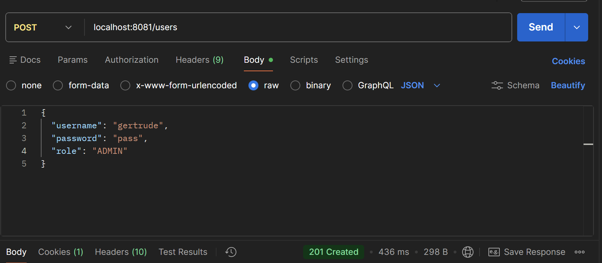
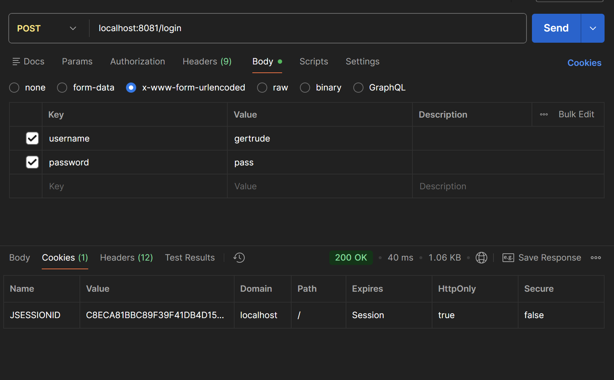
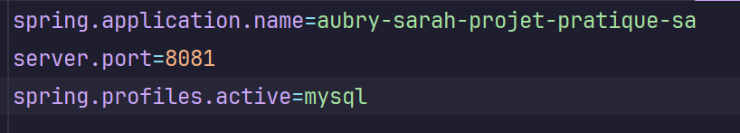

# Projet Spring Web / Api Web
## Sujet
Créer une application de plateformes de discussion.
Voici les directives générales :

* En tant qu'utilisateur je veux pouvoir poster des discussions sur des sujets divers, les catégoriser

* En tant qu'utilisateur je veux pouvoir répondre et participer à une discussion, je veux pouvoir les consulter et les trier

* En tant qu'administrateur je veux pouvoir créer des catégories à disposition des utilisateurs

* En tant qu'administrateur je veux pouvoir gérer les discussions (bloquer, effacer, modérer)
## Déroulé
### Architecture
Le projet a été commencé en suivant les exercices du cours, notamment le chapitre 2 (API Rest):
* Création d'une ressource (discussion)
* Création d'un contrôleur (DiscussionController)
    * interface et implémentation
* Création d'un service (DiscussionService)
* Céation d'un repository.

Il existe deux types de contrôleurs dans l’application : les contrôleurs REST et les contrôleurs Web.

Les contrôleurs REST exposent les routes de l’API et retournent principalement des données (souvent au format JSON). Ils sont destinés à être consommés par des clients comme du JavaScript ou d’autres services.

Les contrôleurs Web assurent la liaison avec les pages HTML. Ils préparent les données pour les vues, déclenchent certaines actions métier et gèrent les redirections entre les différentes pages de l’application.

### Spring Security
Dans le projet, il y a deux rôles principaux : **administrateur** et **utilisateur**. SpringSecurity a été utilisé afin de pouvoir définir des pages spécifiques réservées à chacun de ces rôles.
#### Création d'un compte
Il est possible de créer un compte. A la création d'un compte, l'utilisateur est créé et ajouté dans la table app_user (UserEntity, qui implémente UserDetails de SpringSecurity et gère ainsi les utilisateurs).

#### Connexion
Une fois l'utilisateur connecté, un cookie de session JSESSIONID est généré, ce qui nous permettra d'utiliser les routes sans renseigner de champ de connexion.

Voici un exemple de définition de routes en fonction de chaque rôle :

            // USER
            .requestMatchers("/user/**").hasRole("USER")

            // ADMIN
            .requestMatchers("/admin/**").hasRole("ADMIN")

#### Catégories
Deux catégories sont créées par défaut au lancement de l'application.
Les utilisateurs avec le rôle ADMIN peuvent créer une catégorie et l'option "créer une catégorie" est visible dans la vue (header).
#### Création de discussions
La création de discussions est disponible pour les deux rôles sans restriction, de la même manière: dans un header.
### Thymeleaf
Thymeleaf a été utilisé pour afficher des pages web et les relier à des contrôleurs Web.

## Structure
Les Controllers sont séparés: les fichiers utilisés pour le côté API (@RestController) sont dans le dossier "api", les contrôleurs web (@Controller) sont dans le dossier "web".

### Routes API Rest
#### Discussions
| Route                   | Méthode | Description                                                          | Sécurité                                                        |
| ----------------------- | ------- | -------------------------------------------------------------------- |-----------------------------------------------------------------|
| `/api/discussions`      | GET     | Récupère toutes les discussions non supprimées                       | publique                                                        |
| `/api/discussions/{id}` | GET     | Récupère une discussion par son ID (si non supprimée)                | publique                                                        |
| `/api/discussions`      | POST    | Crée une nouvelle discussion à partir d’un DTO                       | Authentifié                                                     |
| `/api/discussions/{id}` | PUT     | Met à jour le titre, contenu et catégorie d’une discussion existante | publique|
| `/api/discussions/{id}` | DELETE  | Supprime une discussion (soft delete)                                | admin                                                           |
#### Réponses
| Route                         | Méthode     | Description                                   | Sécurité    |
| ----------------------------- | ----------- | --------------------------------------------- | ----------- |
| `/api/answers/{discussionId}` | POST        | Ajoute une réponse à une discussion existante | Authentifié |
#### Catégories
| Route             | Méthode | Description                    | Sécurité         |
| ----------------- | ------- | ------------------------------ | ---------------- |
| `/api/categories` | GET     | Récupère toutes les catégories | publique         |
| `/api/categories` | POST    | Crée une nouvelle catégorie    | Admin uniquement |
#### Utilisateurs
| Route    | Méthode | Description                                  | Sécurité |
| -------- | ------- | -------------------------------------------- | -------- |
| `/users` | POST    | Crée un nouvel utilisateur à partir d’un DTO | publique |

### Routes Web
#### Discussions
| Route                                 | Méthode | Description                                                         | Sécurité    |
| ------------------------------------- | ------- | ------------------------------------------------------------------- | ----------- |
| `/discussions` ou `/discussions/view` | GET     | Affiche toutes les discussions avec filtrage par catégorie possible | publique    |
| `/discussions/new`                    | GET     | Affiche le formulaire de création de discussion                     | Authentifié |
| `/discussions/create`                 | POST    | Crée une discussion depuis le formulaire HTML                       | Authentifié |
#### Catégories
| Route              | Méthode | Description                                           | Sécurité         |
| ------------------ | ------- | ----------------------------------------------------- | ---------------- |
| `/categories/view` | GET     | Affiche toutes les catégories                         | publique         |
| `/categories/new`  | POST    | Crée une nouvelle catégorie depuis le formulaire HTML | Admin uniquement |

### mysql
Il est possible d'utiliser mysql pour ce projet. h2 a été utilisé durant le développement pour visualiser plus facilement les bases de données via l'interface web.
Voici les modifications à effectuer.

Dans le fichier `application.properties`, remplacer "h2" par "mysql".

Lancer le container docker à l'aide de la commande suivante : 

`docker run --name mysqll -e MYSQL_ROOT_PASSWORD=my-secret-pw -e MYSQL_DATABASE=hellospring -p 3306:3306 -d mysql:8.1`

Se connecter avec mysql:
`docker exec -it mysqll mysql -u root -p`

### Tests
